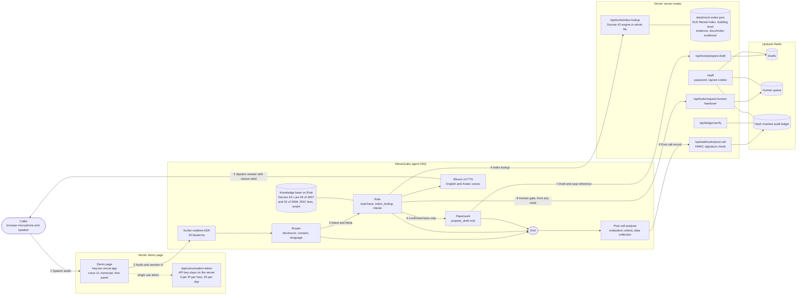

# HAQ architecture (as built)

Flow numbers 1 to 9 match the live flow panel on the demo page (`src/app/components/flows.ts`).

| Flow | What happens | Shown on the panel when |
|---|---|---|
| 1 | Caller speech to the demo page | SDK event: first caller transcript |
| 2 | Audio and session id to the agent (WebRTC) | SDK event: session connected |
| 3 | Router hands intent and fields to Rule, after consent | `index_lookup` was called (it exists only in Rule) |
| 4 | Rule calls `index_lookup`; the server matches DLD's building row and computes the cap | Server: `index_lookup` called |
| 5 | Spoken answer citing "Decree 43 of 2013, Article 1" | Detected in the agent's reply (text match, not a system event) |
| 6 | Rule hands only the confirmed facts to Paperwork | `prepare_draft` was called (it exists only in Paperwork) |
| 7 | `prepare_draft` saves the draft and returns a case reference | Server: `prepare_draft` called |
| 8 | `request_human_handover` adds the case to the human queue (any node) | Server: `request_human_handover` called |
| 9 | ElevenLabs runs the post call analysis (evaluation criteria, data collection) and sends the signed webhook; the summary and analysis are appended to the ledger | Server: signed webhook added to the ledger |

- **Trust boundaries.** The browser never holds the ElevenLabs API key: it gets a single use conversation token. The three tool routes (`index-lookup`, `prepare-draft`, `request-human-handover`) accept only requests carrying the workspace secret header `x-haq-tool-secret`. The webhook accepts only a valid `ElevenLabs-Signature`.
- **Nothing is filed.** No tool submits anything; the draft is for the caller, and filing, disputes and distress go to the human queue. In the browser demo the handover is a callback request, because `transfer_to_number` works only on phone calls.
- **Arithmetic is on the server.** The LLM never computes a cap: `index_lookup` returns the range, cap, maximum new rent and clause from DLD figures copied with evidence.
- **Audit.** Each ledger entry stores `sha256(prev_hash + canonical_json(entry))`; `/api/ledger/verify` and the Verify chain button on `/staff` recompute it.
